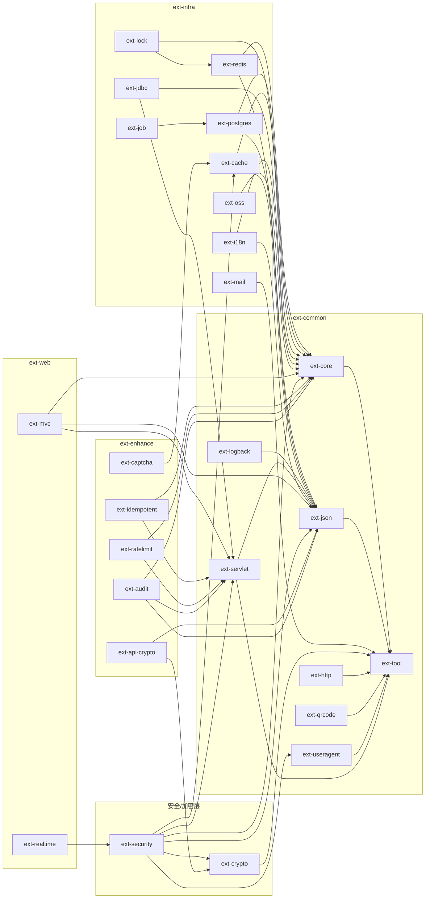

# ext-library 架构

## 拓扑

一个 Gradle 根工程下 26 个可独立发布的叶子模块（含 servlet 基座 `ext-servlet`）。层目录（`ext-common`、`ext-infra`、`ext-security`、`ext-crypto`、`ext-web`、`ext-enhance`）只是 `include` 分组，不产生 artifact——根 `build.gradle` 只对含 `src` 的叶子套 `java-library` + `maven-publish`。

## 分层

自下而上五层：

```
ext-common  →  ext-infra  →  { ext-security, ext-crypto }  →  ext-web  →  ext-enhance
```

- `ext-bom` 不在层内：它是约束层，所有叶子通过 `api platform(project(':ext-bom'))` 继承版本。
- 同层可互相依赖（如 `ext-security` → `ext-crypto`）；跨层只允许上层依赖下层。
- **没有不分层的「杂项层」**：每个模块都落在上面五层之一，依赖方向检查因此没有例外。不需要业务语义的独立工具（`ext-http` / `ext-qrcode` / `ext-useragent` / `ext-logback` 与 servlet 基座 `ext-servlet`）在 `ext-common`；带 Spring 装配或后端集成的 `ext-i18n` / `ext-oss` 在 `ext-infra`。「暂时不知道放哪」不构成新建层的理由——放错层的代价只是新开一条可解释的依赖边。



工具类模块只压在最底层：`ext-http` / `ext-qrcode` / `ext-useragent` 依赖 `ext-tool`，`ext-logback` 依赖 `ext-json`，`ext-servlet` 依赖 `ext-tool` + `ext-json` + `spring-web`（`jakarta.servlet-api` 为 `compileOnly`）；`ext-i18n` 依赖 `ext-core` + `ext-json`，`ext-oss` 依赖 `ext-core`。`ext-realtime` 与 `ext-enhance` 的数个模块对 Redis / PostgreSQL 只有 `compileOnly` 可选边（图中未画）。逐模块的可选边以各模块 spec 与其 `depends-on` 为准。

## 不变量

1. **依赖方向**：下层不得依赖上层，无例外。历史上唯一一条越层边（`ext-security` → `ext-web:ext-mvc`）已随 `ext-servlet` 抽出而消除，回归即视为架构破坏。
2. **模块可单独引入**：任何模块不得把 Redis / PostgreSQL / Caffeine 等重后端声明为 `api` 依赖；可选能力一律 `compileOnly` + 类路径或 Bean 存在性探测。
3. **叶子即 artifact**：目录容器不聚合、不发布；新增模块必须同时登记在 `settings.gradle` 与 `ext-bom` 的 constraints。
4. **版本只在一处**：第三方版本值只出现在 `gradle.properties`，约束只出现在 `ext-bom`；模块 `build.gradle` 不写版本号。
5. **自动配置统一注册**：可装配的模块提供 `*AutoConfiguration`，登记在 `META-INF/spring/org.springframework.boot.autoconfigure.AutoConfiguration.imports`；配置前缀为 `ext.{module}`，仅两处沿用 Spring 既有前缀——`ext-redis` 用 `spring.data.redis`、`ext-mail` 用 `spring.mail`。
6. **包名**：`ext.library.{module}`，模块内再分 `annotation` / `config` / `properties` / `enums` / `strategy` / `util` 等。
7. **口径单一事实源**：数据脱敏策略由 `ext-json` 定义，日志脱敏、接口输出复用同一套策略。
8. **弱模型与 servlet 工具往下放**：请求 / 响应的弱模型（`R`、分页、选项）与 servlet 工具只在 `ext-servlet` 定义一份；下层需要就在下层用，不准因为"下层不能依赖 web"再拄一份同名类。同名类出现两份即视为架构回归。

## 已执行的重构：抽出 `ext-servlet`

`ext-security` 曾经以 `api` 依赖 `ext-web:ext-mvc`（Web 层），只为拿 `R` 与 `ServletUtil` 两个类——唯一一条越层边。基座 `ext-common/ext-servlet` 建成后这条边已消除：

- `R` 与 `ServletUtil` 从 `ext-mvc` 迁入 `ext-servlet`，`ext-mvc` 的原副本删除；
- 分页与选项模型 `PageQuery` / `PageResult` / `SelectData` 迁入；`ext-jdbc` 的同名副本删除，`selectPage` 直接用基座那一套，Web 层不再手工转换；
- 异常 → `(HttpStatus, R)` 的信封组装收进 `ErrorEnvelope`、日志口径收进 `ErrorLog`，`ext-mvc` 的 `GlobalExceptionHandler` 与 `ext-security` 的 `SecurityExceptionHandler` 只声明"哪种异常归我管"与对外消息（顺带消掉了原 `@ResponseStatus` 与响应体状态码不一致的几处：`428` / `412` 统一为 `400`）；
- `ServletUtil` 补 `getRequestOrNull()` / `getResponseOrNull()` 与 `writeJson()`；`ext-audit` / `ext-idempotent` / `ext-ratelimit` / `ext-lock` 里手写的 `instanceof ServletRequestAttributes` 样板一并删掉；
- 新增 `RepeatableRequestWrapper` + 可选过滤器（默认关闭），供需要多次读取请求体的模块使用；
- `ext-security` 改为依赖 `ext-servlet`，`ext-realtime` 不再借道 `ext-mvc` 取 `spring-webmvc`。

不选「下沉进 `ext-core`」的原因：`ext-core` 被几乎所有模块依赖，让它带上 servlet 语义会把 web 基座变成全库默认前提。

## 待执行的重构

1. **迁移 5 个模块目录**：`ext-http` / `ext-qrcode` / `ext-useragent` / `ext-logback` 从 `ext-misc` 迁到 `ext-common`，`ext-i18n` / `ext-oss` 迁到 `ext-infra`，`ext-misc` 层目录随之删除。本仓库的 spec 已按目标位置就位，代码目录仍是旧的 `ext-misc/`——两者不一致期间以 spec 表述的分层为准。
2. **待定**：`X-Request-Id` 透传与 MDC 字段（`ext-servlet` ⑤）是新能力，默认开关与字段名未定，实施前需先确认；当前 `ext-servlet` 未实现该能力。

## 跨模块决策

- **版本收敛**：Spring 全家桶经 `spring-boot-dependencies` 导入；自己带 BOM 的第三方（如 `software.amazon.awssdk:bom`）导它的 BOM；不在任何 BOM 的第三方（bouncycastle / zxing / swagger-annotations / springdoc / sshd）逐个在 `ext-bom` 约束。这样消费方只导一个 BOM，模块之间不会出现版本漂移。
- **重后端 `compileOnly` + 类路径探测**：目的是让消费方只引自己用得上的后端、不被意外拖入 Redis / PostgreSQL；切换后端靠"引入哪个依赖"，配置只选行为不选类（`AUTO` 优先 Redis）。该原则在 `ext-cache`、`ext-idempotent`、`ext-ratelimit`、`ext-realtime`、`ext-i18n`、`ext-oss` 上一体适用。
- **接入方式**：横切能力用注解 + 切面（`@Cache`、`@RedisLock`、`@Idempotent`、`@RateLimit`、`@OperationLog`、`@RequestDecrypt`）；可选实现用 SPI + 自动探测（`CacheStrategy`、`RateLimitStore`、`LockStore`、`ObjectStorage`、`PubSub`、`AuditHandler`、`TranslationSource`）。
- **配置类型**：时长用 `Duration`（`30d`、`1h`、`3m`），语言用 `Locale`，不暴露裸毫秒数与字符串枚举常量。
- **构建**：Gradle Groovy DSL，JDK 25 toolchain；编译带 `-parameters` 与 `-Xlint:deprecation,unchecked,rawtypes`；`compileJava` 显式依赖 `processResources`，否则配置元数据处理器读不到 `additional-spring-configuration-metadata.json`。

## 测试与验证（已知限制）

- **无 CI**：构建与测试只在本地 `./gradlew` 执行，提交前没有自动门禁。
- **多数模块无自动化测试**：`ext-enhance` 全部 5 个模块、`ext-realtime`、`ext-infra` 的 postgres / job / jdbc / mail / lock / i18n / oss、`ext-logback` 的 `test` 目录为空或不存在；有测试的集中在 `ext-tool`、`ext-core`、`ext-json`、`ext-servlet`、`ext-cache`、`ext-redis`、`ext-crypto`、`ext-security`、`ext-http`、`ext-qrcode`、`ext-useragent`、`ext-mvc`，合计 300 余个用例。
- 因此新增或改动行为必须自带测试，不能指望既有测试兜底。
